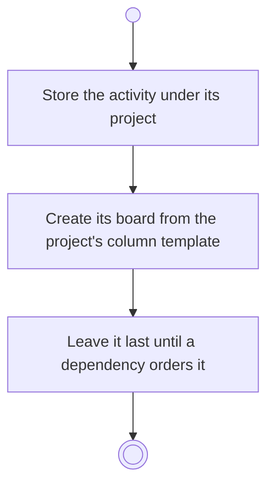

# BP18.02 — Create an activity

> GENERATED by `bpmn-dsl si-export` — do not edit; the source is the `call` block in the
> `.bpd` (#1182/ADR-068, keyed by call site per ADR-069).
>
> hash: `sha256:91aed02f75830e2192e7e9ced09b5d0bac120686d7eaecb216638ccb32b5e72e`

## BP18_PlanAProjectsCourse — Activity diagram

### Bound rules

| Where | Rule |
|---|---|
| Store the activity under its project | `BR-98` |
| Create its board from the project's column template | `BR-101` |
| Leave it last until a dependency orders it | `BR-119` |

### Messages

| Where | Message | To | Payload |
|---|---|---|---|
| Create an activity | Activity created | User | — |

### Notes

- **Create an activity**: Activities are flat: finer granularity means more activities, never sub-activities. A board exists because its owner was created.
