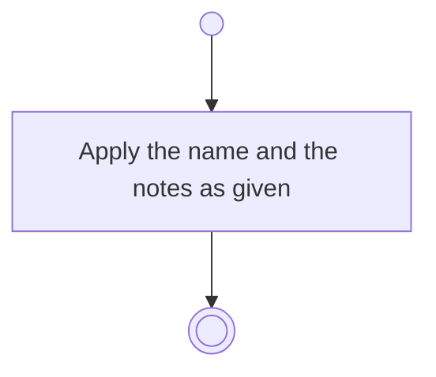

# BP18.03 — Amend an activity

> GENERATED by `bpmn-dsl si-export` — do not edit; the source is the `call` block in the
> `.bpd` (#1182/ADR-068, keyed by call site per ADR-069).
>
> hash: `sha256:56160298c6c2f8f54117e94ad1ef85aa5257eed150a0c5422ec4c36da1c4b263`

## BP18_PlanAProjectsCourse — Activity diagram

### Bound rules

| Where | Rule |
|---|---|
| Apply the name and the notes as given | `BR-98` |

### Messages

| Where | Message | To | Payload |
|---|---|---|---|
| Amend an activity | Activity amended | User | — |

### Notes

- **Amend an activity**: The state is not among them: it is set by its own request.
