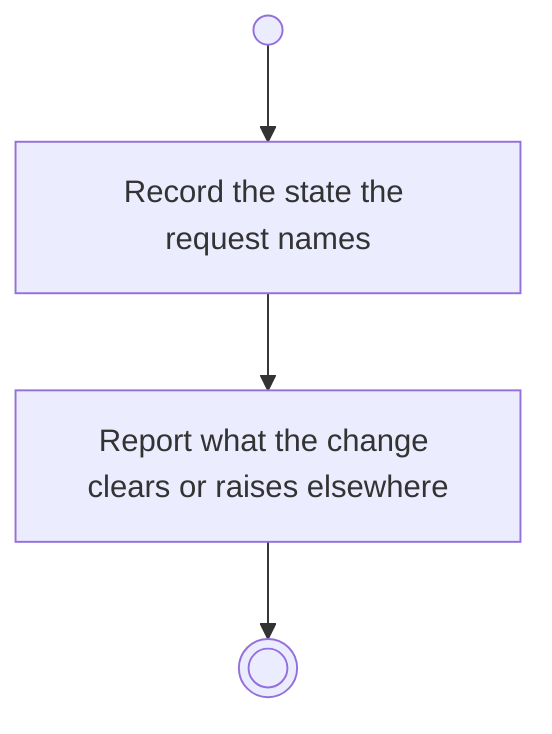

# BP18.04 — Set an activity's state

> GENERATED by `bpmn-dsl si-export` — do not edit; the source is the `call` block in the
> `.bpd` (#1182/ADR-068, keyed by call site per ADR-069).
>
> hash: `sha256:616714c9b5f08cdd1ce176be44f65b5c161877a82974ff31ca3f6d6d9d56017e`

## BP18_PlanAProjectsCourse — Activity diagram

### Bound rules

| Where | Rule |
|---|---|
| Record the state the request names | `BR-109` |
| Report what the change clears or raises elsewhere | `BR-110` |

### Messages

| Where | Message | To | Payload |
|---|---|---|---|
| Set an activity's state | State recorded | User | — |

### Notes

- **Set an activity's state**: One request serves Todo, InProgress and Done, and reopening a Done activity. This is also where BP11's completion offer lands.
