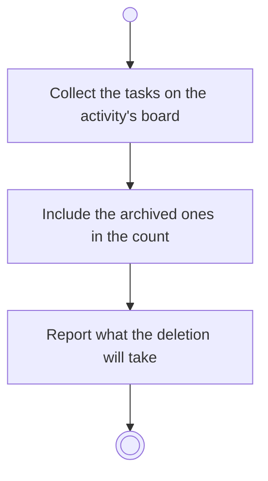

# BP18.05 — See what deleting an activity takes

> GENERATED by `bpmn-dsl si-export` — do not edit; the source is the `call` block in the
> `.bpd` (#1182/ADR-068, keyed by call site per ADR-069).
>
> hash: `sha256:81e87ef35ef3ef53e7537bb527adcd5e915c8b8b138f808b17c8c66a4257cccc`

## BP18_PlanAProjectsCourse — Activity diagram

### Bound rules

| Where | Rule |
|---|---|
| Collect the tasks on the activity's board | `BR-104` |
| Include the archived ones in the count | `BR-117` |
| Report what the deletion will take | `BR-113` |

### Messages

| Where | Message | To | Payload |
|---|---|---|---|
| See what deleting an activity takes | What the activity deletion will take | User | — |

### Notes

- **See what deleting an activity takes**: A task needs a board, so declining has no legal outcome: the gesture is approved or abandoned. The dependency edges simply go.
