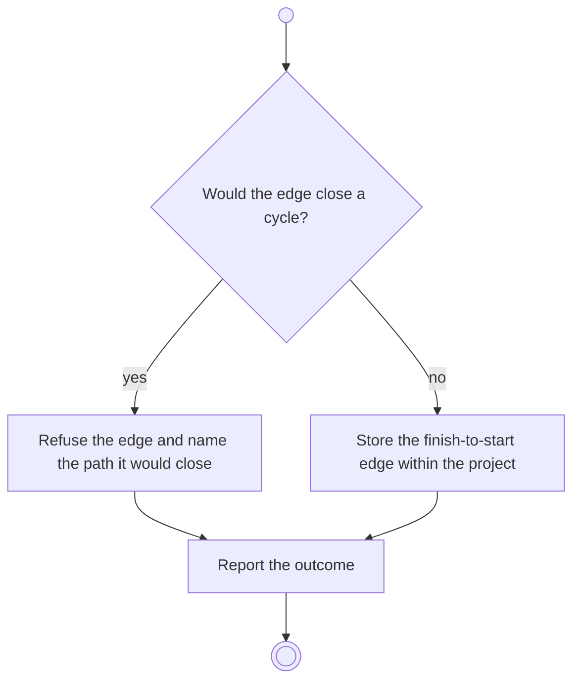

# BP18.07 — Add a dependency

> GENERATED by `bpmn-dsl si-export` — do not edit; the source is the `call` block in the
> `.bpd` (#1182/ADR-068, keyed by call site per ADR-069).
>
> hash: `sha256:b4b7d169932e08f0f6a92bbb0d1b1b1cd082b7374486d5265eccc4cf8e742831`

## BP18_PlanAProjectsCourse — Activity diagram

### Bound rules

| Where | Rule |
|---|---|
| "Would the edge close a cycle?" | `BR-100` |
| Store the finish-to-start edge within the project | `BR-99` |

### Messages

| Where | Message | To | Payload |
|---|---|---|---|
| Add a dependency | Dependency recorded, or refused | User | — |

### Notes

- **Add a dependency**: No start-to-start, no lag, no overlap, and no edge to another project's activity. There is one dependency type, and it is technical.
