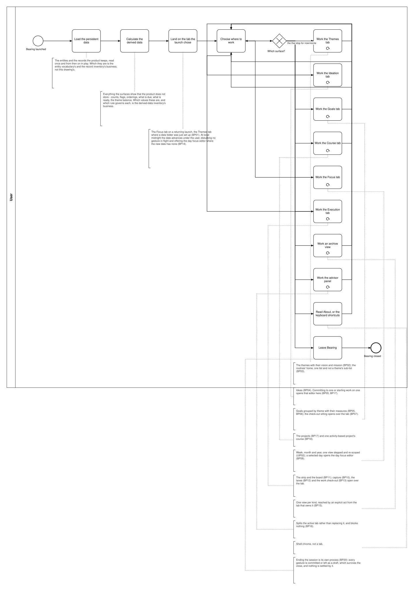

# UIP01 — Work in Bearing

**Stage.** Discovery / Mockup — before the Intent gate. Nothing here is const.

| | |
|---|---|
| **What it is** | A **User Interface Process**: how the user moves between the surfaces, and that each surface is worked until they leave it. |
| **What it is not** | A business process. It decides nothing a business rule decides, mints no call site and asks the system for nothing. The nineteen BPs carry the acts; this carries the path between them. |
| **Why it exists** | The page and its loop are needed to understand how the system works, and they are not business — so they are drawn once, here, instead of inside every process (SA 2026-10-17). |
| **Source** | `diagrams/UIP01_WorkInBearing.bpd` — one output, there being no system chain to collapse. |

## The path

Start-up **loads the persistent data** — the entities of Intent §3 and the records of
[`11_Record-Inventory.md`](../../01_Planning/11_Record-Inventory.md) — and then **calculates the
derived data**, every value a surface shows that the product does not store, each one listed with
the rule that governs it in
[`13_Derived-Data-Inventory.md`](../../01_Planning/13_Derived-Data-Inventory.md). From then on the
surfaces work from what is in play: no process draws a page read, and arriving on a surface asks
the system for nothing (DRW-14).

The launch lands the user on a tab; from there the tab bar is always in front of them, every surface
is current without being asked (BR-118), and the date may advance underneath at local midnight
without disturbing a gesture in flight (BP14). Each surface is **worked until the user leaves it** —
the loop marker on its box — and what can be done on it, in which order, is the owning process's
business and is not redrawn here. An editor, a dialog or a menu is not a surface of its own: it
opens over the surface whose act it serves and comes back to it.

## Surface by surface

| Surface | What is on it | Acts drawn by | Opens over it |
|---|---|---|---|
| Themes tab | The themes with their vision and mission; the routines' home, one list and not a theme's sub-list (BR-02, BR-10) | BP02, BP03 | Theme editor · Routine editor · Vision & Mission editor · Delete confirmation |
| Ideation tab | The ideas the filter and the ordering in force admit | BP04 | Idea editor · Goal editor (committing to an idea, BP05) · Project editor (starting work on one, BP17) |
| Goals tab | The active goals grouped by theme, with their active progress measures | BP05, BP06 | Goal editor · Progress check-in · Goal check-out sitting (BP07) · Project editor |
| Course tab | The projects with their counts, and one activity-based project's course | BP17, BP18 | Project editor · Activity editor · Dependency editor |
| Focus tab | Week, month and year — one view, stepped and re-scoped | UIP02 | Day focus editor (BP08) · the logs covering a selected day, read in place |
| Execution tab | The board strip and the board in front of it | BP11 | Task creation (BP10) · Column overflow menu (BP12) · Work check-out (BP13) · Task editor · Task context menu |
| Archive views | One view per archivable kind, reached by an explicit act from the tab that owns the kind (BR-26) | BP15 | Delete confirmation |
| Advisor panel | The session's conversation and its outstanding proposals; it splits the active tab and blocks nothing | BP16 | Whatever the applied proposal's own operation discloses |
| Shell chrome | About, the keyboard shortcuts, the toasts and the skeleton loaders; leaving the product | BP20 | — |

## What this drawing surfaces

1. **The tab bar in `wf §1` has five tabs — Themes, Ideation, Goals, Focus, Execution — and the
   drawings open a sixth, the Course tab** (`BP17`, `BP18`). The wireframe source predates the
   projects work, whose screen models Intent §7 still marks as owed.
2. ~~**Leaving the product is drawn by no business process.**~~ **Closed 2026-10-17**: it is
   `BP20 — Close Bearing` now, minted on the Software Architect's word. `BP01.09` keeps the
   refusal path's own close.
