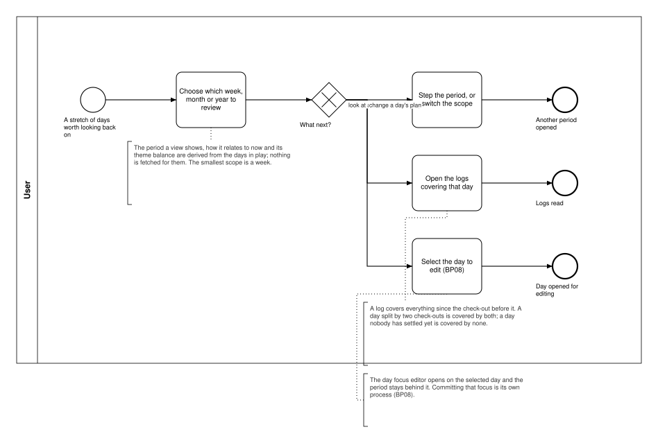

# UIP02 — Choose focus period

**Stage.** Discovery / Mockup — before the Intent gate. Nothing here is const.

| | |
|---|---|
| **What it is** | A **User Interface Process**: the path through the focus views — choosing which week, month or year to look at, stepping it, reading the logs that explain a day, and opening a day to re-plan it. |
| **What it is not** | A business process. It asks the system for nothing: everything these views show is derived from what is in play. |
| **Was** | `BP09 — Review focus history` until 2026-10-17. Its last two call sites went with the page reads (`BP09.01`, `BP09.02`, retired, ids never reused), and a process with no system interaction is no business process (SA 2026-10-17). The id `BP09` is retired with it. |
| **Source** | `diagrams/UIP02_ChooseFocusPeriod.bpd` |

## The path

The smallest scope is a week; there is no day-scoped view (BR-93). Whichever period is showing, the
view states which period that is and how it relates to now (BR-46), and shows the theme balance over
it (BR-47) — all of it derived, listed as `D-11`, `D-12` and `D-13` in
[`13_Derived-Data-Inventory.md`](../../01_Planning/13_Derived-Data-Inventory.md). Three things follow
from there: step the period or switch the scope, which is the same view again; open the logs covering
a day, where a day may be explained by two logs, by one, or by none while the span is still open
(BR-38, BR-33); or select a day to edit, which opens the day focus editor over the period and hands
over to **BP08**, the one business process this path reaches.

## What it hands over to

| Act | Hands to | What that process does |
|---|---|---|
| Select the day to edit | `BP08 — Set a day's focus` | commits that date's boards, activities and routines |
